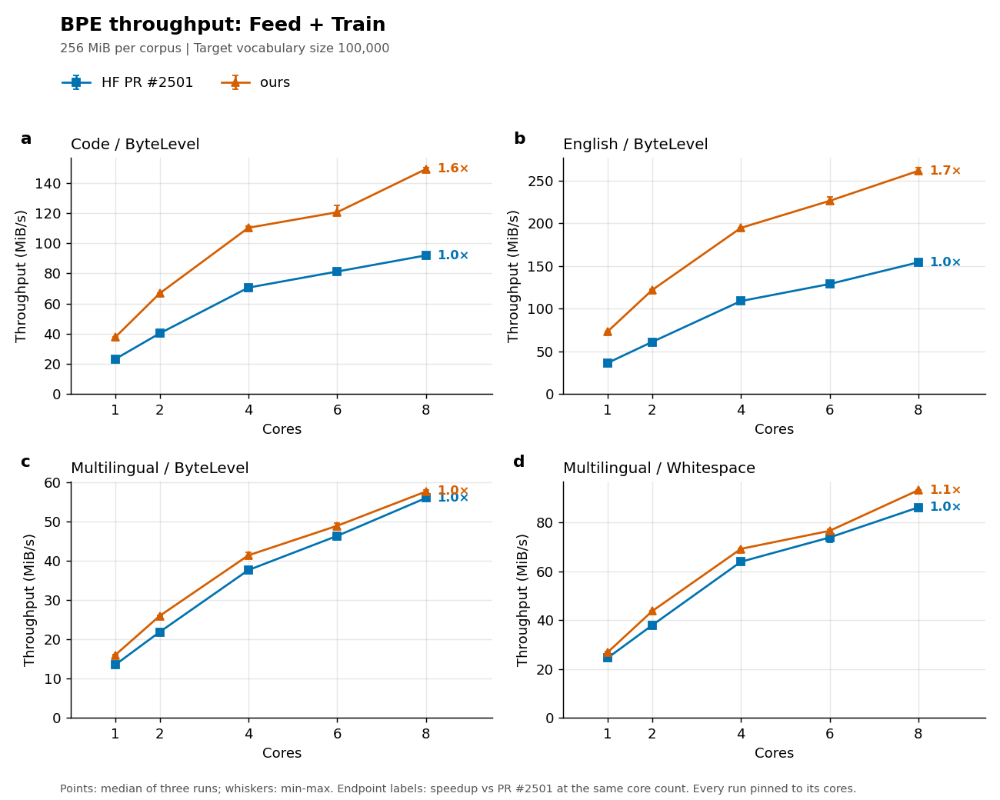
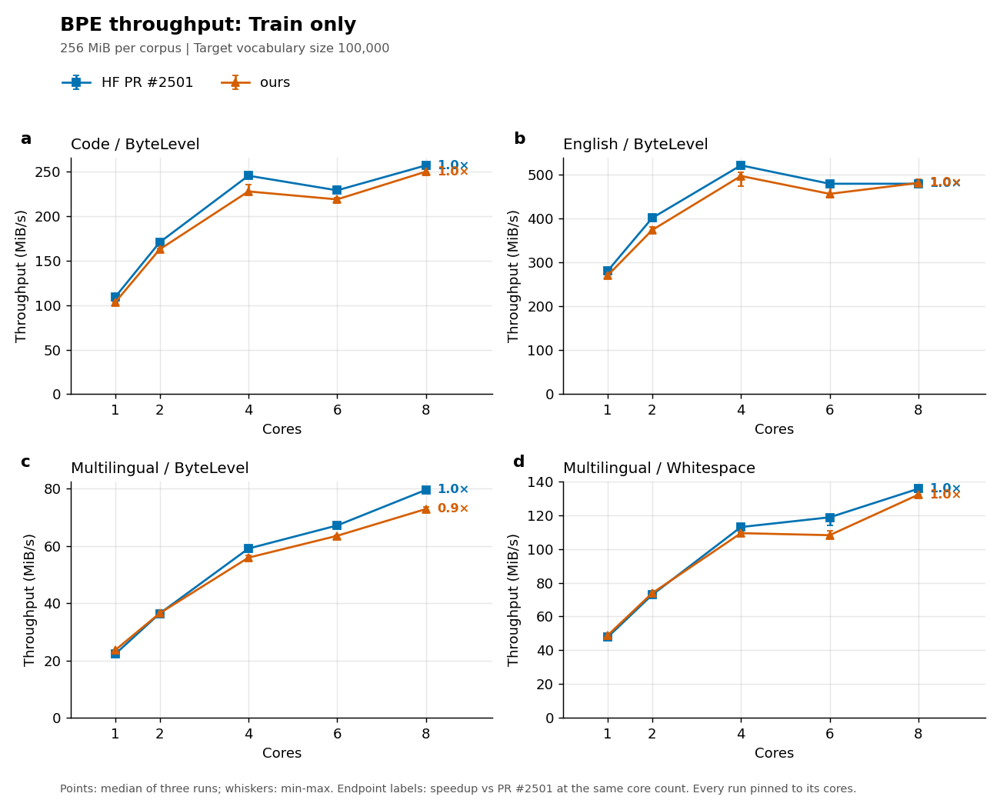
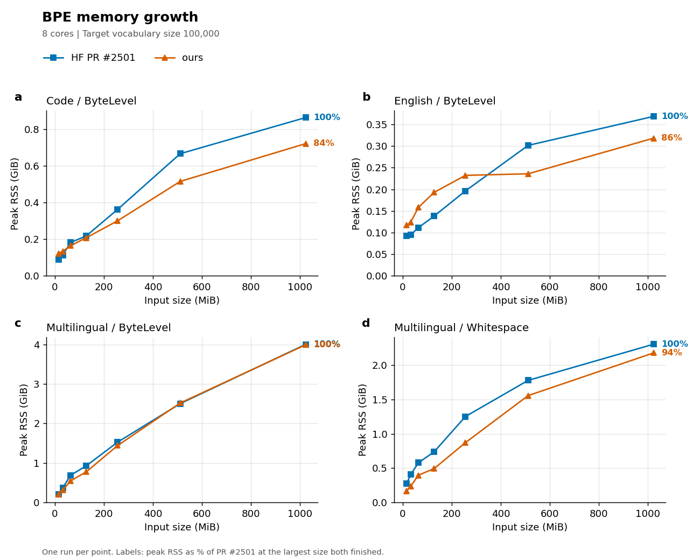

# toki — exact, fast BPE

[](https://www.youtube.com/watch?v=kbyIS9vdarM)

BPE training and encoding that reproduce [HuggingFace `tokenizers`](https://github.com/huggingface/tokenizers)
**bit for bit** (every merge, the vocab, every token id), faster and with less memory than the fastest code that
exists: HF `main` (the 1.0 rewrite) for encoding and Yikai Liao's parallel trainer
[huggingface/tokenizers#2501](https://github.com/huggingface/tokenizers/pull/2501) for training.

**Ours** combines both sides:
- **encoding**: HF `main`'s per-word engine (SIMD pre-tokenizer, word cache, merge engines) inside our driver: every
  thread finds its own chunk at a safe cut point, reads it with `pread`, encodes it and writes its ids; streaming, so
  memory stays flat;
- **training**: our counting (parallel chunked reads, arena word maps, bounded per-thread maps flushed into a sharded
  global map) feeding PR #2501's parallel merge loop.

| dir | what |
|---|---|
| [`ours/`](ours) | ours: `toki-encode` (built against HF `main`) and `toki-train` (against PR #2501): [`ours/build.sh`](ours/build.sh) |
| [`patches/`](patches) | the upstream patches: [HF `main`: encode one long input on every thread](patches/hf-main-encode-long-input.diff), [PR #2501: train from entries](patches/pr2501-do-train-entries.diff) |
| [`rust_bpe/`](rust_bpe) | pre-tokenizers, normalizers and safe cut points shared by ours; our first trainer and encoder |
| [`bench_server/`](bench_server) | benchmark ([`toki_axes.sh`](bench_server/toki_axes.sh), [`toki_tables.py`](bench_server/toki_tables.py)), HF drivers (`hfenc`, `hfbench`) |

## Experiments

**Default setting:** 1 GB (10⁹ bytes), 8 threads, GPT-2 byte-level pre-tokenizer, vocab 131 072, no normalizer,
2× AMD EPYC 7742. Each table below swaps **one** axis of the default and keeps the rest; every value runs on all 4
datasets. **Training**: ours vs PR #2501 (its Rust `BpeTrainer`, with HF's own pre-tokenizer and normalizers), on the
whole sample. **Encoding**: ours vs HF `main` (from Rust, its batch `encode`), on the held-out half of each sample, with
the vocab trained on the other half. Every run is pinned to exactly N cores (HF 1.0 ignores `RAYON_NUM_THREADS`);
time = median of 2 runs, bytes/s = bytes processed (training: the whole sample; encoding: the held-out half) per second, MEM = peak memory in GB. Per-dataset tables:
[BY_DATASET.md](bench_server/results_toki/BY_DATASET.md).

**Exactly what is compared:**

| | version | how it is run |
|---|---|---|
| HF `main` (encoding baseline) | [`ff8ae1ba`](https://github.com/huggingface/tokenizers/commit/ff8ae1baabca0707b7fa9f22854652e231a933de) (2026-10, the 1.0 rewrite; not on PyPI) | from Rust, no Python: [`hfenc`](bench_server/hfenc/src/main.rs) cuts the whole file into ~256 KB pieces at safe cut points and passes them to HF's batch `encode`, which uses its own thread pool |
| PR #2501 (training baseline) | [`e4f787dc`](https://github.com/Yikai-Liao/tokenizers/commit/e4f787dc189d9be7192107490d652096cde7480e) (its head: `main` `ff8ae1ba` + the PR) | from Rust: [`hfbench`](bench_server/hfbench/src/main.rs) feeds each line (with its `\n`), normalized and pre-tokenized by HF's own parts from a `tokenizer.json`, to its `BpeTrainer` |
| ours | this repo, built against the two commits above | [`toki-encode`](ours/encode/src/main.rs), [`toki-train`](ours/train/src/main.rs) |

- **Same input for everyone:** the whole file. No baseline gets a smaller or pre-split input.
- **Time and memory:** wall time and peak RSS of the whole process (`/usr/bin/time`), including loading the
  tokenizer, reading the input and writing the ids or the vocab.
- **Correctness:** checked on every run. Our merges and vocab must equal PR #2501's, and our ids must equal HF
  `main`'s, token by token.
- **Build:** Rust 1.99.0, `--release`, no `target-cpu=native`, Linux 6.4.

### Data

| dataset | source |
|---|---|
| english | [fineweb-edu](https://huggingface.co/datasets/HuggingFaceFW/fineweb-edu) (sample/100BT) |
| multilingual | [fineweb-2](https://huggingface.co/datasets/HuggingFaceFW/fineweb-2), 7 languages |
| code | [github-code-clean](https://huggingface.co/datasets/codeparrot/github-code-clean) |
| mix | english + multilingual + code, 1:1:1 |

Each sample is drawn at random from a 100 GB pool.

### Results (average of the 4 datasets)

<!-- tables -->
Equivalence: 143 training runs of ours, 143 with merges identical to PR #2501's; 142 encoding runs, 142 with ids identical to HF main's (token by token).

#### Default setting

| dataset | PR #2501 train s | bytes/s | MEM | **ours** train s | bytes/s | MEM | HF main enc s | bytes/s | MEM | **ours** enc s | bytes/s | MEM |
|---|---|---|---|---|---|---|---|---|---|---|---|---|
| english | 5.21 | 192 MB/s | 0.37 | **2.48** (2.1×) | **402 MB/s** | **0.31** | 1.80 | 278 MB/s | 0.69 | **0.99** (1.8×) | **503 MB/s** | **0.31** |
| multilingual | 16.2 | 62 MB/s | 4.04 | **13.5** (1.2×) | **74 MB/s** | **3.98** | 2.99 | 167 MB/s | 0.77 | **1.83** (1.6×) | **272 MB/s** | **0.37** |
| code | 9.34 | 107 MB/s | 1.19 | **4.71** (2.0×) | **212 MB/s** | **0.87** | 2.33 | 215 MB/s | 0.87 | **1.23** (1.9×) | **407 MB/s** | **0.37** |
| mix | 🕐 | 🕐 | 🕐 | 🕐 | 🕐 | 🕐 | 🕐 | 🕐 | 🕐 | 🕐 | 🕐 | 🕐 |
| **average** | 🕐 | 🕐 | 🕐 | 🕐 | 🕐 | 🕐 | 🕐 | 🕐 | 🕐 | 🕐 | 🕐 | 🕐 |

#### Threads

| threads | PR #2501 train s | bytes/s | MEM | **ours** train s | bytes/s | MEM | HF main enc s | bytes/s | MEM | **ours** enc s | bytes/s | MEM |
|---|---|---|---|---|---|---|---|---|---|---|---|---|
| 2 | 🕐 | 🕐 | 🕐 | 🕐 | 🕐 | 🕐 | 🕐 | 🕐 | 🕐 | 🕐 | 🕐 | 🕐 |
| 4 | 🕐 | 🕐 | 🕐 | 🕐 | 🕐 | 🕐 | 🕐 | 🕐 | 🕐 | 🕐 | 🕐 | 🕐 |
| 8 | 🕐 | 🕐 | 🕐 | 🕐 | 🕐 | 🕐 | 🕐 | 🕐 | 🕐 | 🕐 | 🕐 | 🕐 |
| 16 | 🕐 | 🕐 | 🕐 | 🕐 | 🕐 | 🕐 | 🕐 | 🕐 | 🕐 | 🕐 | 🕐 | 🕐 |

#### Vocab

| vocab | PR #2501 train s | bytes/s | MEM | **ours** train s | bytes/s | MEM | HF main enc s | bytes/s | MEM | **ours** enc s | bytes/s | MEM |
|---|---|---|---|---|---|---|---|---|---|---|---|---|
| 32k | 🕐 | 🕐 | 🕐 | 🕐 | 🕐 | 🕐 | 🕐 | 🕐 | 🕐 | 🕐 | 🕐 | 🕐 |
| 64k | 🕐 | 🕐 | 🕐 | 🕐 | 🕐 | 🕐 | 🕐 | 🕐 | 🕐 | 🕐 | 🕐 | 🕐 |
| 128k | 🕐 | 🕐 | 🕐 | 🕐 | 🕐 | 🕐 | 🕐 | 🕐 | 🕐 | 🕐 | 🕐 | 🕐 |
| 256k | 🕐 | 🕐 | 🕐 | 🕐 | 🕐 | 🕐 | 🕐 | 🕐 | 🕐 | 🕐 | 🕐 | 🕐 |

#### Pre-tokenizer

| pre-tokenizer | PR #2501 train s | bytes/s | MEM | **ours** train s | bytes/s | MEM | HF main enc s | bytes/s | MEM | **ours** enc s | bytes/s | MEM |
|---|---|---|---|---|---|---|---|---|---|---|---|---|
| bytelevel | 🕐 | 🕐 | 🕐 | 🕐 | 🕐 | 🕐 | 🕐 | 🕐 | 🕐 | 🕐 | 🕐 | 🕐 |
| llama3 | 🕐 | 🕐 | 🕐 | 🕐 | 🕐 | 🕐 | 🕐 | 🕐 | 🕐 | 🕐 | 🕐 | 🕐 |
| gpt4o | 🕐 | 🕐 | 🕐 | 🕐 | 🕐 | 🕐 | 🕐 | 🕐 | 🕐 | 🕐 | 🕐 | 🕐 |
| whitespace | 🕐 | 🕐 | 🕐 | 🕐 | 🕐 | 🕐 | 🕐 | 🕐 | 🕐 | 🕐 | 🕐 | 🕐 |
| whitespace_split | 🕐 | 🕐 | 🕐 | 🕐 | 🕐 | 🕐 | 🕐 | 🕐 | 🕐 | 🕐 | 🕐 | 🕐 |
| metaspace | 🕐 | 🕐 | 🕐 | 🕐 | 🕐 | 🕐 | 🕐 | 🕐 | 🕐 | 🕐 | 🕐 | 🕐 |
| bert | 🕐 | 🕐 | 🕐 | 🕐 | 🕐 | 🕐 | 🕐 | 🕐 | 🕐 | 🕐 | 🕐 | 🕐 |
| punctuation | 🕐 | 🕐 | 🕐 | 🕐 | 🕐 | 🕐 | 🕐 | 🕐 | 🕐 | 🕐 | 🕐 | 🕐 |
| digits | 🕐 | 🕐 | 🕐 | 🕐 | 🕐 | 🕐 | 🕐 | 🕐 | 🕐 | 🕐 | 🕐 | 🕐 |
| unicode_scripts | 🕐 | 🕐 | 🕐 | 🕐 | 🕐 | 🕐 | 🕐 | 🕐 | 🕐 | 🕐 | 🕐 | 🕐 |
| char_delimiter | 🕐 | 🕐 | 🕐 | 🕐 | 🕐 | 🕐 | 🕐 | 🕐 | 🕐 | 🕐 | 🕐 | 🕐 |

#### Normalizer

| normalizer | PR #2501 train s | bytes/s | MEM | **ours** train s | bytes/s | MEM | HF main enc s | bytes/s | MEM | **ours** enc s | bytes/s | MEM |
|---|---|---|---|---|---|---|---|---|---|---|---|---|
| none | 🕐 | 🕐 | 🕐 | 🕐 | 🕐 | 🕐 | 🕐 | 🕐 | 🕐 | 🕐 | 🕐 | 🕐 |
| nfc | 🕐 | 🕐 | 🕐 | 🕐 | 🕐 | 🕐 | 🕐 | 🕐 | 🕐 | 🕐 | 🕐 | 🕐 |
| nfd | 🕐 | 🕐 | 🕐 | 🕐 | 🕐 | 🕐 | 🕐 | 🕐 | 🕐 | 🕐 | 🕐 | 🕐 |
| nfkc | 🕐 | 🕐 | 🕐 | 🕐 | 🕐 | 🕐 | 🕐 | 🕐 | 🕐 | 🕐 | 🕐 | 🕐 |
| nfkd | 🕐 | 🕐 | 🕐 | 🕐 | 🕐 | 🕐 | 🕐 | 🕐 | 🕐 | 🕐 | 🕐 | 🕐 |
| lowercase | 🕐 | 🕐 | 🕐 | 🕐 | 🕐 | 🕐 | 🕐 | 🕐 | 🕐 | 🕐 | 🕐 | 🕐 |
| strip_accents | 🕐 | 🕐 | 🕐 | 🕐 | 🕐 | 🕐 | 🕐 | 🕐 | 🕐 | 🕐 | 🕐 | 🕐 |
| nfkc_lowercase | 🕐 | 🕐 | 🕐 | 🕐 | 🕐 | 🕐 | 🕐 | 🕐 | 🕐 | 🕐 | 🕐 | 🕐 |
| replace | 🕐 | 🕐 | 🕐 | 🕐 | 🕐 | 🕐 | 🕐 | 🕐 | 🕐 | 🕐 | 🕐 | 🕐 |
| bert | 🕐 | 🕐 | 🕐 | 🕐 | 🕐 | 🕐 | 🕐 | 🕐 | 🕐 | 🕐 | 🕐 | 🕐 |

#### Size

| size | PR #2501 train s | bytes/s | MEM | **ours** train s | bytes/s | MEM | HF main enc s | bytes/s | MEM | **ours** enc s | bytes/s | MEM |
|---|---|---|---|---|---|---|---|---|---|---|---|---|
| 1 GB | 🕐 | 🕐 | 🕐 | 🕐 | 🕐 | 🕐 | 🕐 | 🕐 | 🕐 | 🕐 | 🕐 | 🕐 |
| 10 GB | 🕐 | 🕐 | 🕐 | 🕐 | 🕐 | 🕐 | 🕐 | 🕐 | 🕐 | 🕐 | 🕐 | 🕐 |


<!-- /tables -->

### Training vs PR #2501 (its three figures, rerun)

256 MiB per corpus, vocab 100 000, pinned cores; merges identical in all 176 runs. Feed + train is 1.0-1.7× faster
(the counting); train alone is the same merge loop; peak memory 84-100% of PR #2501's at 1 GiB.





## Upstream

- **HF `main`, encoding** ([patch](patches/hf-main-encode-long-input.diff), 77 lines added, 7 removed): `main` splits a
  long input across threads only at special tokens, so one long text is encoded on one thread. The patch also cuts long
  text before a `\n` between ASCII letters/digits when the pre-tokenizer always ends a word there (GPT regexes,
  whitespace, BERT) and the normalizers work char by char. One 0.5 GB input on 16 cores: 3.95 s → 0.49 s; ids identical
  on all 68 tested configurations; `tk-encode` tests pass.
- **PR #2501, training** ([patch](patches/pr2501-do-train-entries.diff), 6 lines): `do_train_entries`, training from
  `(word, count)` entries without building a map of them.

## Reproduce

```bash
cd bench_server
PYTHON=python3.11 ./setup.sh
venv-x86_64/bin/python prepare_data.py data 100 1 10
BASE=0 ./enc_heldout.sh results_enc_ho3             # held-out halves and their vocabs
../ours/build.sh <tokenizers main checkout> <tokenizers PR #2501 checkout>
BASE=0 ./toki_axes.sh results_toki
python3 toki_tables.py results_toki/results.tsv results_toki
```

## History

I started by implementing models and ML algorithms from scratch. At the same time I got very excited about
pre-training, partly through my project [chsm8](https://huggingface.co/LegumMagister/chsm8): seeing which data leads
to which result made me read a lot about pre-training and its best practices. After a couple of models I moved on to
tokenizers, to figure out how they work.

I wrote my own BPE in C++ without looking at how it is done in practice; my competitive programming background helped
me work out how I would implement it. My implementation (not BPE itself) turned out a bit different, and with an
agent I made it more parallel: a 10-20× speedup for training and 10-33× for encoding.

When I was about to open a PR, I found [Yikai](https://github.com/Yikai-Liao)'s [PR](https://github.com/huggingface/tokenizers/pull/2501) and realized
I had compared against a year-old release: HF [`main`](https://github.com/huggingface/tokenizers) had moved on, Yikai's trainer is much faster than mine, and
`main`'s encoder is a bit faster than mine. Since we got our speedups in different ways, combining them should beat
both. So with an agent I built (HF `main`, mine) for encoding and (PR #2501, mine) for training.

I'm really glad [HF tokenizers](https://github.com/huggingface/tokenizers) made such a leap in just one year: compared with the [0.22 release](https://github.com/huggingface/tokenizers/releases/tag/v0.22.0), `main` encodes 12-20×
faster with about the same memory and trains 1.1-2.4× faster, and Yikai's PR #2501 trains 8-20× faster with 4-5× less
memory. Combined with mine, 10 GB is now encoded in seconds, not minutes.

In the beginning I could follow; by the end I no longer understood the changes going on:
[this](https://www.youtube.com/watch?v=W_dxteeedgs).
